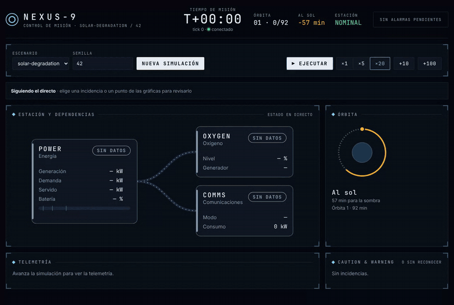
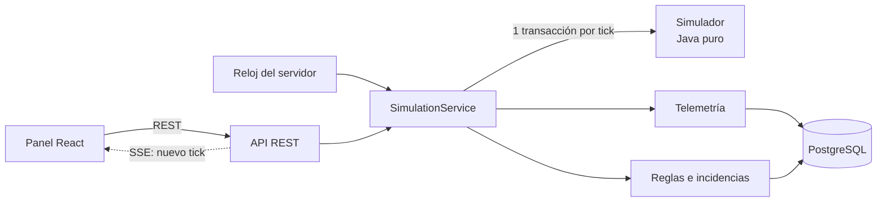

# NEXUS-9

Un centro de control para una estación espacial denominada "NEXUS-9". Hay un simulador que genera la telemetría de energía, oxígeno y comunicaciones, y un backend que la guarda, vigila con reglas y abre incidencias cuando algo va mal.

Quería que las averías tuvieran causa y efecto, no números aleatorios en un dashboard. Si fallan los paneles solares, baja la generación, la batería se va vaciando, la estación recorta consumo para aguantar y al final el generador de oxígeno se queda sin energía. Todo eso sale del modelo.


**Pruébalo:** https://nexus-9-aftv.onrender.com.



## Qué hace

- Simula la estación tick a tick (1 tick = 1 minuto): órbita con día y noche, paneles, batería, oxígeno y comunicaciones.
- Reparte la energía por prioridad y pone las comunicaciones en ahorro cuando baja la batería.
- Trae cuatro escenarios:
  - `nominal`: no pasa nada (sirve para comprobar que no salta ninguna alarma).
  - `solar-degradation`: fallan los paneles y la avería acaba llegando al oxígeno.
  - `oxygen-leak`: una fuga gana al generador de O₂ hasta que se repara en el tick 300.
  - `solar-storm`: una tormenta deja los paneles al 40 % entre los ticks 180 y 420; la estación aguanta y se recupera.
- Guarda telemetría e incidencias en PostgreSQL.
- Tiene 5 reglas con histéresis, y cada incidencia sabe a qué otros módulos puede afectar según un grafo de dependencias.
- La simulación corre en el servidor y el panel (React) se actualiza en directo con Server-Sent Events.
- Desde el panel se pueden reconocer las alarmas, volver a cualquier tick del historial y saltar de una incidencia al momento en que se abrió.

La parte que más me interesaba es la consistencia. Si el backend se reinicia a mitad de escenario o llegan eventos repetidos, el historial tiene que quedar igual y no puede haber incidencias duplicadas. Eso no lo garantizan comprobaciones en Java, sino la propia base de datos (claves únicas y un índice único parcial). Lo explico en el [ADR 0002](docs/adr/0002-idempotencia-en-base-de-datos.md) y el [ADR 0005](docs/adr/0005-reconstruir-estacion-por-replay.md).

## Arquitectura



El reloj del servidor avanza las simulaciones que están en marcha. Después de cada tick, el backend avisa por SSE y el panel pide `/state`, que devuelve módulos, incidencias y lecturas nuevas leídos en el mismo tick, así nunca se mezclan datos de dos momentos distintos. Lo cuento en el [ADR 0006](docs/adr/0006-reloj-en-servidor-y-sse.md).

Es un monolito modular con dos módulos Maven: `simulator`, en Java sin Spring, y `backend`, con Spring Boot. El panel vive en `frontend/` (React + Vite + TypeScript) y Maven lo compila y lo mete dentro del jar, así que al final se despliega una sola cosa.

## Cómo ejecutarlo

Necesitas Java 21 y Docker.

```bash
./mvnw verify                  # tests unitarios y de integración (PostgreSQL con Testcontainers)
docker compose up --build      # PostgreSQL + backend; panel en http://localhost:8080
./scripts/demo.sh              # ejecuta el escenario de avería de paneles
```

Si vas a tocar el panel, con el backend arrancado en el 8080 puedes usar Vite con recarga en caliente:

```bash
cd frontend && npm install && npm run dev   # http://localhost:5173
```

La demo crea una simulación de `solar-degradation` con semilla 42 y saca esto:

```
== currentTick 150   POWER DEGRADED   OXYGEN NOMINAL   COMMS NOMINAL
== currentTick 400   POWER CRITICAL   OXYGEN NOMINAL   COMMS OFFLINE
== currentTick 450   POWER OFFLINE    OXYGEN OFFLINE   COMMS OFFLINE

GENERATION_DEFICIT  120
COMMS_DEGRADED      314
BATTERY_LOW         342
BATTERY_CRITICAL    382
OXYGEN_LOW          421
```

## API

| Método | Ruta |
|---|---|
| `GET` | `/api/scenarios` |
| `GET` | `/api/demo` — la simulación con la que abre la demo pública |
| `POST` | `/api/simulations` — `{"seed": 42, "scenario": "solar-degradation"}` |
| `GET` | `/api/simulations/{id}` |
| `POST` | `/api/simulations/{id}/advance?ticks=N` o `?toTick=T` (idempotente) |
| `POST` | `/api/simulations/{id}/run?speed=N` y `/pause` — reloj del servidor |
| `GET` | `/api/simulations/{id}/events` — Server-Sent Events |
| `GET` | `/api/simulations/{id}/state?fromTick=T` — todo el panel leído en un mismo tick |
| `GET` | `/api/simulations/{id}/modules` |
| `GET` | `/api/simulations/{id}/modules/{POWER\|OXYGEN\|COMMS}/readings?fromTick&toTick` |
| `GET` | `/api/simulations/{id}/incidents?status=OPEN\|RESOLVED` |
| `POST` | `/api/simulations/{id}/incidents/{incidentId}/acknowledge` |

Los errores siguen el formato Problem Details (RFC 9457).

## Stack

Java 21 · Spring Boot 4 · PostgreSQL 17 · React 19 · TypeScript · Vite · Spring JDBC · Flyway · JUnit 5 · Testcontainers · Vitest · ESLint · Docker · GitHub Actions · Render · Neon

## Documentación

- [Especificación](docs/especificacion.md)
- [Plan de la v0.1](docs/plan-v0.1.md)
- [Decisiones de arquitectura (ADR)](docs/adr/)
- [Cómo está desplegado](docs/despliegue.md)
- [Cambios por versión](CHANGELOG.md)

## Lo siguiente

- Sacar el simulador a un proceso aparte que mande los eventos por HTTP, para enfrentarme a reintentos y eventos desordenados de verdad.
- Operadores con login y roles.

## Licencia

[MIT](LICENSE)
