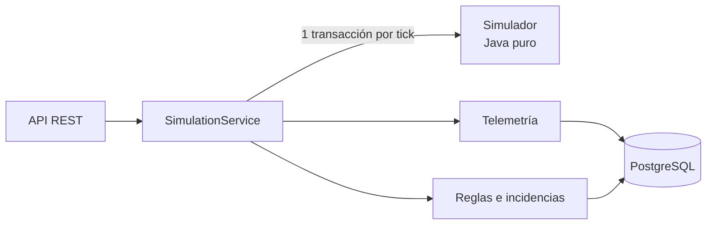

# NEXUS-9

Software de supervisión para una estación espacial ficticia. Un simulador determinista genera la telemetría de energía, oxígeno y comunicaciones; el backend la guarda, aplica reglas y abre incidencias con prioridad.

Las averías no son números aleatorios: si fallan los paneles solares baja la generación, la batería se descarga, la estación recorta consumo y al final el generador de oxígeno se queda sin energía.


## Qué hace (v0.1)

- Simulación por ticks (1 tick = 60 s) con órbita luz/sombra, paneles, batería, oxígeno y comunicaciones.
- Reparto de energía por prioridad y ahorro de comunicaciones cuando baja la batería.
- Escenarios con averías programadas (`nominal`, `solar-degradation`).
- Telemetría e incidencias en PostgreSQL.
- 5 reglas con histéresis y módulos afectados según un grafo de dependencias.
- API REST.

Lo interesante está en la consistencia: aunque se reinicie el backend o lleguen eventos duplicados, el historial es el mismo y no se duplican incidencias. Lo garantiza la base de datos (claves únicas e índice único parcial), no comprobaciones en el código. Ver [ADR 0002](docs/adr/0002-idempotencia-en-base-de-datos.md) y [ADR 0005](docs/adr/0005-reconstruir-estacion-por-replay.md).

## Arquitectura



Monolito modular con dos módulos Maven: `simulator` (sin dependencias de Spring) y `backend` (Spring Boot).

## Cómo ejecutarlo

Requisitos: Java 21 y Docker.

```bash
./mvnw verify                  # tests unitarios y de integración (PostgreSQL con Testcontainers)
docker compose up --build      # PostgreSQL + backend en http://localhost:8080
./scripts/demo.sh              # ejecuta el escenario de avería de paneles
```

Salida de la demo:

```
== currentTick 150   POWER DEGRADED   OXYGEN NOMINAL   COMMS NOMINAL
== currentTick 400   POWER CRITICAL   OXYGEN NOMINAL   COMMS OFFLINE
== currentTick 450   POWER OFFLINE    OXYGEN OFFLINE   COMMS OFFLINE

GENERATION_DEFICIT  120
COMMS_DEGRADED      314
BATTERY_LOW         342
BATTERY_CRITICAL    382
OXYGEN_LOW          421
```

## API

| Método | Ruta |
|---|---|
| `GET` | `/api/scenarios` |
| `POST` | `/api/simulations` — `{"seed": 42, "scenario": "solar-degradation"}` |
| `GET` | `/api/simulations/{id}` |
| `POST` | `/api/simulations/{id}/advance?ticks=N` |
| `GET` | `/api/simulations/{id}/modules` |
| `GET` | `/api/simulations/{id}/modules/{POWER\|OXYGEN\|COMMS}/readings?fromTick&toTick` |
| `GET` | `/api/simulations/{id}/incidents?status=OPEN\|RESOLVED` |

## Stack

Java 21 · Spring Boot 4 · PostgreSQL 17 · Spring JDBC · Flyway · JUnit 5 · Testcontainers · Docker · GitHub Actions

## Documentación

- [Especificación v0.1](docs/especificacion-v0.1.md)
- [Plan de tareas](docs/plan-v0.1.md)
- [Decisiones de arquitectura (ADR)](docs/adr/)

## Próximos pasos

- Simulador como proceso separado que envía eventos por HTTP (reintentos, eventos desordenados).
- Operadores con login y roles, y ciclo de incidencias `OPEN → ACKNOWLEDGED → RESOLVED`.
- Panel web con alarmas en tiempo real (WebSockets).
